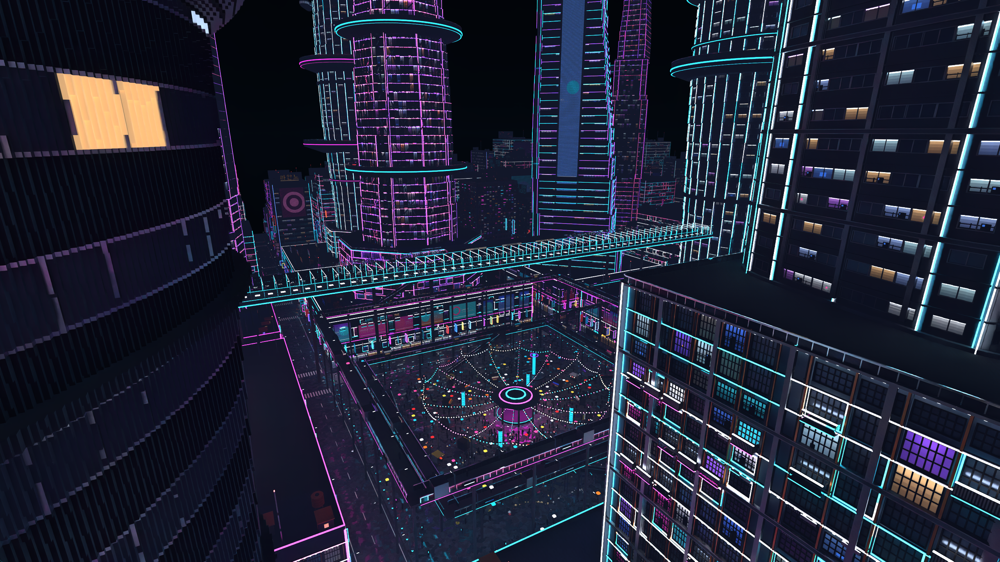

# Caelix Renderer: Towards A Million Stars

## Key Decisions

Raw signal should contain **minimal temporal and spatial correlation**.

- That is, we increase raw signal quality without heavy spatial-temporal reuse.

> We rely on production-grade denoisers to lift the heavy work, rather than re-inventing something as complicated as ReSTIR PT by ourselves. If we ever need one, we can do it just by then.
>
> For now, this gives us results good enough.

**Maintain a list of light source voxels.**

- This list must be optimized for efficient sampling and minimal memory footprint.
- Sacrifice construction time since strong emissive voxels are rare.

> Without being able to sample lights, it is hard to do many light rendering with tiny bright voxels. We tried ReSTIR GI (Original and NAADF's modification) and they don't work.

**Use Light BVH**. We need to sample light from arbitrary world position for volumetrics.

### New Assumptions / Engine Guidelines

**Strong emissive** voxels, especially **editing** them, will be expensive.

- By default, strong means `material.emission >= 20`.
- If you ever need to use them, keep them static (less edits) and compact (span less bricks).
- Weak emissive voxels are as cheap as regular voxels.
- As a consequence, strong emissive voxels rarely animates. Use weak ones for animations.
  - Their light strengths can still animate frequently, within some reasonable range so the light CDF don't recompute.

## Approach

*Code presented here are pseudo code.*

### Light List, the emitters

We use this to hold strong emissive voxels' data:

A device-local list, of bricks that containing strong emissive voxels.

Each brick lighting record mainly contains:

```c
struct LightRecord {
    float total_weight;		// Brick's weight (liminance sum)
    float face_weight[6];	// Each exposed faces' weight (sum)
    // some sort of extent and metadata
    
    // Densely packed, strong emissive voxel faces (exposed only)
    uint face_header[6];	// u16 offset, u16 count
    struct FaceData{
        u16 data; 			// 3bit X, 3bit Y, 3bit Z; 7bit reserved
    }[...];
}
```

> Whether we use fixed length record as in branch `light-nee-experiments` or a variable length record as above still needs discussion. I lean towards compact one due to sampling efficiency.
>
> Or, do we use PDF textures (for bricks)?

#### Sampling Light Bricks

In `light-nee-experiments` we use prefix sum + binary search. However, this is slow for scenes like `meridian-deep`:



~~For an ultimate solution, we should use a `B=4` sum tree (streaming world) + alias table (render group) for sampling the lights.~~ We use light BVH to sample the lights, where light bricks are leaves and render groups are BLASs (TLAS leaves).

#### Sampling Points on Emissive Surfaces

Given a brick `LightRecord`, we

1. Sample a face, pdf = `face_weight / total_weight`
2. Jump to `face_header[face]` buffer
3. Sample a voxel, pdf = `1 / face_header[face].count` (uniformly)
4. Sample a point on `(voxel, face)`

This gives us a point on the emissive surface.

### Light Cell, the receivers

There are too many lights to sample meaningfully. Therefore, We guide light sampling with a map **Hit vertex (entity + position + normal) -> important local lights**: A device-local hashmap.

Key = spatial regions, Value = list of important lights of that region. (ReGIR style)

- Level 0 region: 32 x 32 x 32 vx
- Level 1 region: 128 x 128 x 128 vx

```c
Hashkey ComputeHashkey(Hit v, RNG pixelRNG)
{
    int cellSize = AdaptiveSize(v.worldXYZ, camera.worldXYZ, globalSettings);
	return Hash(
        v.entityId,
        (int3)pixelRNG.HalfCellJitter(v.worldXYZ / cellSize),
        v.normal
    );
}
```

For the hashmap we use a buffer with linear probing, since this map will be super dynamic (as our viewpoint changes). We have to insert a lot so no cuckoo.

The goal of keeping this spatial partition is to get a list of locally important lights: We have to pick from the global giant light list. To do so, we use Resampled Importance Sampling (RIS):

```c#
struct LightCellData {
    Reservoir slots[N_RES];
    // Sun visibility hint
}

// Each frame
[numthreads(N_RES, 1, 1)]
void Fill()
{
    foreach(Cell cell in alive_cells)
    {
        if(threadId.x == 0)
            // Bookkeeping work: cell lifespan, visibility hint decay, ...
        
        for(i in 0..M)
        {
            Light l = SampleLight();
            slots[threadId.x].AddSampleWithTemporalReuse(
                l, p_hat(cell, l)
            );
        }
    }
}
```

Default params:

- `N_RES` = 64
- `M` = `max(2, 16 - cell.life_in_frames)`
- Cell life = 128 frames after cold
- Linear probe max step 8
  - Keep a filling rate ~ 50%. Adjust `AdaptiveSize` dynamically to achieve the target filling rate.

### Next Event Estimation

Each vertex `v` along a traced path may access its grid `ComputeHashkey(v, pRNG)` to sample a non-sun light. It samples a brick uniformly from cell reservoir slots, then sample an emissive point on that brick.

NEE then shoots an additional ray (a shadow ray) towards the light. To ensure performance, we (by default) keep a shadow ray budget shared by sun (main) light and non-sun lights:

- Primary + 2 bounces + 2 shadow rays (1 per vertex) total. (p -> NEE @p -> b1 -> NEE @b1 -> b2)

Clearly we need a rule to choose between sun and no sun so we fit 2 rays in this 1 ray budget.

#### Multiple Importance Sampling


#### For vertices that are close to lamps

To reduce bias, when a bounce ray hits a strong emissive voxel, 